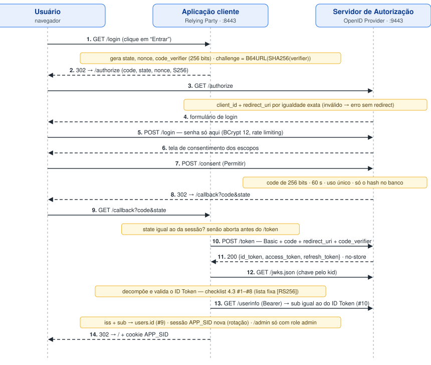

# Relatório — A1/3 Cyber Security (33506)
## Autenticação e Autorização: OAuth 2.0 + OpenID Connect (Authorization Code com PKCE) — Opção 1

**Acadêmicos:** Samuel De Marco · _[nome do colega]_  ·  **Professor:** Odemir Moreira da Mata Junior  ·  **Entrega:** 26/11/2026

**Repositório:** https://github.com/SamuelDeMarco-Dev/OAuth-2.0-OpenID-Connect-Authorization-Code-com-PKCE-

## 1. O que foi implementado

Dois componentes independentes em **Java 21 / Spring Boot 4.1** (páginas renderizadas no servidor), sem bibliotecas prontas de OAuth/OIDC — o protocolo foi implementado à mão; a biblioteca Nimbus JOSE+JWT é usada apenas para as operações criptográficas de JWS/JWK.

- **Servidor de Autorização (OpenID Provider)** — `https://localhost:9443`: descoberta, `/authorize`, login, consentimento, `/token` (`authorization_code` e `refresh_token` rotativo), `/userinfo`, `/jwks.json` e `/logout`.
- **Aplicação cliente (Relying Party)** — `https://localhost:8443`: início do login com PKCE S256, `/callback`, validação do ID Token, vínculo `iss`+`sub` com a tabela `users`, sessão local e rota `/admin` restrita por `role`.

Tudo trafega em HTTPS, inclusive em localhost; o cliente valida o certificado do AS com um truststore próprio. Segredos (`client_secret`, chave privada, senhas) ficam em `.env`/`secrets/`, fora do repositório. São **166 testes automatizados** (94 no AS, 72 no cliente) e um script que executa os 15 testes negativos do item 5 contra os dois apps em execução.

## 2. Diagrama do fluxo implementado



A senha só trafega entre o navegador e o Servidor de Autorização (passo 5). O cliente só envia ao AS o `code_challenge`; o `code_verifier` sai do servidor da aplicação apenas no canal de retaguarda (passo 10). Os tokens nunca chegam ao navegador: depois do passo 13 eles são descartados e a aplicação passa a usar a própria sessão (`APP_SID`).

## 3. ID Token decodificado (execução real)

Saída do log do cliente no passo 7 do §4.2 (`IdTokenInspector`, marcador `[ID_TOKEN]`), login do usuário `admin`:

**Cabeçalho**
```json
{ "kid": "2026-11", "typ": "JWT", "alg": "RS256" }
```

**Payload**
```json
{
  "iss": "https://localhost:9443",
  "sub": "9958d86d-84f8-461d-b45f-b8ac7ddc314e",
  "aud": "app-cybersecurity-33506",
  "azp": "app-cybersecurity-33506",
  "iat": 1794874468,
  "exp": 1794875368,
  "nonce": "tki2bwY7JroQxlsohmHTvn492tRwbs7-zOvDnvvDp1E",
  "jti": "e4d60cb4-f23f-4ab4-af5c-7a53cc90adbf",
  "name": "Administrador Demo",
  "email": "admin@example.com",
  "email_verified": true,
  "role": "admin"
}
```
`exp − iat = 900 s`. O `kid` corresponde à chave publicada em `/jwks.json` (`kty=RSA`, `use=sig`, `alg=RS256`).

**Assinatura** (RS256, 256 bytes, Base64URL)
```
KPMyWUwmNjUX_y7xTvGTCg-lblcxc58rURW-GNCayIEkFw3rZp2XjzMZY7ewYQ6wyItRDEPRzmpZY82U2eJfXMpnrfajHQMmyvXolwsAuyKTAqZtXBYR4_pfubWh2tDV9yhc5hHuQD6-ZTPlngAw78lKyI5Zshh4DYfh-ry2iH-ph880llFfhErOPgskChli8KrAdQp6Pw4G3Vlys5V1v7qZ1eSd4QzPrjDJN8-pPjal_XMT0ijyeaqa9rYmrFpZIyBPAXTDIPUAQ5mtzeL2YLmN9sq9fx6uWQCdryuhJVvZIFybk_McxIMBDOWnJiytfA90wrL-Gr3gqKokxW7YFA
```

## 4. Checklist de validação do ID Token (item 4.3)

Cada linha aprovada gera uma linha de evidência no log do cliente (`IdTokenValidator`, `UserInfoClient`, `UserLinkService`). Evidências da mesma execução da seção 3:

| # | Verificação | Evidência (log da execução real) | Teste automatizado |
|---|---|---|---|
| 1 | Assinatura com a chave do emissor pelo `kid`; `kid` desconhecido é erro | `#1 assinatura RS256 conferida com a chave kid=2026-11 do JWKS do emissor` | `item1_*` (3), `negativo12` |
| 2 | Algoritmo na lista fixa; `none` sempre rejeitado | `#2 alg RS256 está na lista fixa [RS256]` | `negativo01`, `negativo02`, `item2_*` |
| 3 | `iss` idêntico ao issuer da descoberta | `#3 iss == https://localhost:9443` | `negativo04`, `item3_*` |
| 4 | `aud` contém o client_id | `#4 aud [app-cybersecurity-33506] contém app-cybersecurity-33506` | `negativo03`, `item4_*` |
| 5 | `aud` múltiplo → `azp` validado | `#5 aud único, azp == app-cybersecurity-33506` | `item5_*` (3) |
| 6 | `exp` no futuro (tolerância 60 s) | `#6 exp 2026-11-17T00:29:28Z está no futuro (tolerância 60 s)` | `negativo05`, `item6_*` |
| 7 | `iat` não está no futuro | `#7 iat 2026-11-17T00:14:28Z não está no futuro` | `negativo06`, `item7_*` |
| 8 | `nonce` idêntico ao enviado | `#8 nonce idêntico ao enviado no /authorize` | `negativo07`, `item8_*` |
| 9 | `sub` localizado na tabela e convertido no `id` interno | `Usuário criado a partir de ID Token validado: iss=https://localhost:9443 sub=9958d86d-… -> id=1` | `UserLinkServiceTest` (5) |
| 10 | `sub` do `/userinfo` igual ao do ID Token | `#10 sub do /userinfo idêntico ao do ID Token (9958d86d-…)` | `UserInfoClientTest`, `CallbackControllerTest` |

**Lista fixa de algoritmos (RFC 8725 §3.1).** A lista `accepted-algorithms: [RS256]` vem da configuração e a aplicação nem inicia se houver algo fora da família RSA. O `alg` do cabeçalho é apenas **comparado** com essa lista; o verificador é sempre `RSASSAVerifier` com a chave do JWKS. Por isso um token `alg=none` ou “reassinado em HS256 com a chave pública” é recusado antes de qualquer verificação de assinatura.

**Usuário inexistente (passo 10 do §4.2).** O registro é criado **apenas com dados validados**: `oidc_iss` + `oidc_sub` do token aprovado; `user_name` recebe o e-mail somente se `email_verified=true`. O e-mail nunca localiza usuário: o mesmo e-mail com outro `sub` vira outra conta (testado). A `role` é atualizada a cada login a partir do token validado e relida do banco a cada requisição.

## 5. Testes negativos obrigatórios (item 5)

Executados com `./collections/negative-tests.sh` contra os dois apps em execução (TLS e chaves reais, banco limpo), em 16/11/2026: **20 verificações OK, 0 falhas** (alguns cenários têm mais de uma variação). Os cenários 1–7 e 12 atacam o validador de ID Token do cliente com tokens forjados (classe `NegativeIdTokenTests`, chave RSA gerada no teste), pois o cliente só recebe ID Tokens pelo canal de retaguarda com o AS legítimo.

| # | Cenário | Esperado | Obtido | Evidência adicional |
|---|---|---|---|---|
| 1 | ID Token com `alg "none"` | Rejeitado | Rejeitado (item 2) | `negativo01_algNone_rejeitado` |
| 2 | Reassinado em HS256 com a chave pública como segredo | Rejeitado | Rejeitado (item 2) | `negativo02_hs256ComChavePublica_rejeitado` |
| 3 | `aud` de outro client_id | Rejeitado | Rejeitado (item 4) | `negativo03_audDeOutroCliente_rejeitado` |
| 4 | `iss` diferente do emissor | Rejeitado | Rejeitado (item 3) | `negativo04_issDiferente_rejeitado` |
| 5 | `exp` vencido | Rejeitado | Rejeitado (item 6) | `negativo05_expVencido_rejeitado` |
| 6 | `iat` no futuro | Rejeitado | Rejeitado (item 7) | `negativo06_iatNoFuturo_rejeitado` |
| 7 | `nonce` diferente do enviado | Rejeitado | Rejeitado (item 8) | `negativo07_nonceDiferente_rejeitado` |
| 8 | Callback com `state` divergente / ausente | Fluxo abortado antes da troca | HTTP 400, sem cookie `APP_SID` (2 variações) | log: `Callback com state divergente — possível CSRF. Fluxo abortado ANTES da troca do code.` |
| 9 | Reutilização do mesmo code | `invalid_grant` + revogação | 2ª troca: 400 `invalid_grant`; `/userinfo` com o token da 1ª troca: 401 | log: `Reutilização de authorization code detectada (…): 3 tokens revogados` |
| 10 | `code_verifier` incorreto no `/token` | `invalid_grant` | HTTP 400 `invalid_grant` | `negativo10_codeVerifierIncorreto_invalidGrant` |
| 11 | `redirect_uri` com barra final, parâmetro adicional, subcaminho | Rejeitado (comparação exata) | HTTP 400, página de erro **sem** `Location` (3 variações) | `negativo11_*` (8 variações, incl. caixa, porta, fragmento) |
| 12 | Um byte alterado na assinatura | Rejeitado | Rejeitado (item 1) | `negativo12_byteAlteradoNaAssinatura_rejeitado` |
| 13 | `/admin` com `role = user` | HTTP 403 | `aluno`: 403 · `admin`: 200 | log: `Acesso NEGADO a /admin para user_id=2 role=user` |
| 14 | `/userinfo` sem token / token inválido | 401 + `WWW-Authenticate` | 401 `Bearer realm="authorization-server"`; adulterado: 401 `error="invalid_token"` | expirado: `negativo14b_tokenExpirado_401ComWwwAuthenticate` |
| 15 | Força bruta no formulário | Bloqueio | 5 senhas erradas: 401 ×5; 6ª tentativa **com a senha correta**: 429 | log: `Login bloqueado por excesso de tentativas: user:aluno até …` |

## 6. Justificativa das escolhas

**Algoritmo: RS256 (RSA 2048 + SHA-256).** Com assinatura assimétrica o cliente valida o token com a chave **pública** do JWKS e não consegue forjar tokens; com HS256 o cliente teria o mesmo segredo que assina e o segredo precisaria ser distribuído a cada aplicação — o PDF proíbe esse uso. RS256 é o algoritmo obrigatório do OIDC (Core §15.1) e o mais interoperável (o próprio Google o usa). A chave tem `kid` (`AAAA-MM`) e a rotação mantém a chave anterior publicada no JWKS; o cliente relê o JWKS uma vez quando aparece um `kid` novo (no máximo uma vez a cada 10 s, para que tokens forjados não virem amplificador de requisições).

**Tempos de vida.**

| Artefato | Duração | Motivo |
|---|---|---|
| Authorization code | 60 s, uso único | Só precisa sobreviver ao redirecionamento; a janela curta e o uso único limitam a interceptação (RFC 6749 §4.1.2). Reuso revoga a família de tokens. |
| Access token | 15 min | Portador sem prova de posse: vida curta limita o estrago de um vazamento; revogável no AS (lista por `jti`). |
| ID Token | 15 min | Usado uma única vez, no login, para criar a sessão; não autoriza nada depois. |
| Refresh token | 8 h, rotativo | Igual à sessão absoluta; a rotação com detecção de reuso revoga a família (RFC 9700 §4.14). |
| Sessão local (`APP_SID`) | 30 min de inatividade / 8 h absoluta | Sugestão do PDF; equilibra uso contínuo num turno de trabalho com exposição limitada de um cookie roubado. |
| Tolerância de relógio | 60 s | “Poucos minutos” segundo o PDF; cobre diferença de relógio sem aceitar tokens vencidos de verdade. |

**Outras decisões de segurança.** Senhas com BCrypt custo 12; o mesmo custo é pago para usuário inexistente e a mensagem de falha é idêntica (não revela a existência da conta). Rate limiting por usuário (5 falhas em 5 min → bloqueio de 15 min, inclusive para a senha correta) e por IP. Sessões dos dois lados com id aleatório de 128 bits ou mais, `HttpOnly; Secure; SameSite=Lax`, rotacionadas no login e transportadas **somente por cookie** (o id nunca aparece na URL); no cliente o banco guarda apenas o SHA-256 do id. Codes e refresh tokens também ficam só como hash. `redirect_uri` é comparada por igualdade exata de string e, se inválida, o erro é exibido sem redirecionar (evita *open redirect*). Respostas do `/token` sempre com `Cache-Control: no-store` e `Pragma: no-cache`. O access token tem `typ=at+jwt`, diferente do ID Token, para que um não seja aceito no lugar do outro.
